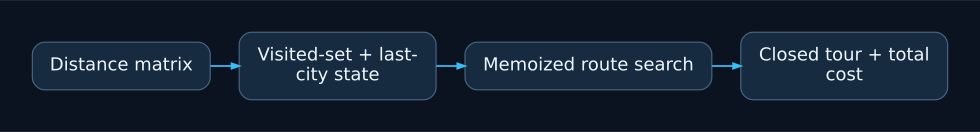
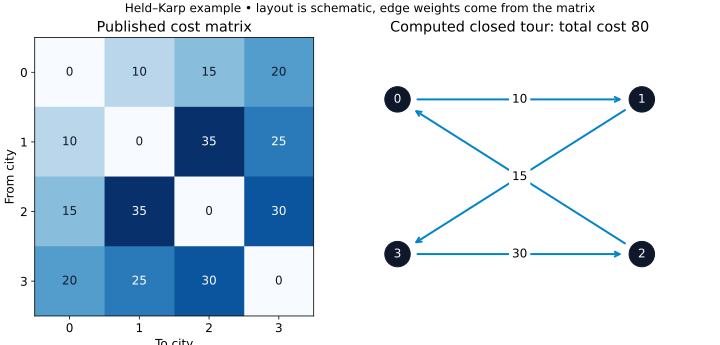

# Travelling Salesman Problem Experiments

Educational comparison of exact dynamic programming (Held-Karp) in Python and
C#, with a separate nearest-neighbor heuristic. Maintainer: Mateusz Sury.

```sh
python -m pip install -r requirements.txt
python tsp_python.py --min-size 4 --max-size 10
python -m unittest -v
dotnet build Tsp.csproj -c Release
dotnet run --project Tsp.csproj -c Release --no-build -- --self-test
dotnet run --project Tsp.csproj -c Release --no-build
```

Use Python 3.10+ and .NET SDK 8. Both exact implementations now generate the
same seeded LCG distance matrices. Memoization retains both cost and route;
tests check a known optimal cost and a complete closed tour. The exact algorithm
has exponential time and memory requirements, so defaults cover only 4–10 cities.
Increasing the range to 20 can still consume substantial memory.

`tsp_rand_bez_rekurencji.py` is heuristic: it does not guarantee the shortest tour.
The checked-in `wyniki_*` files are historical measurements from the original
scripts and may use different input generation. Regenerate matched inputs and
record runtime, versions and hardware before making performance comparisons.

Generated binaries belong in release assets; build output is ignored. MIT license.

## Project overview

Educational Held-Karp implementations with seeded matrices and route validation.



The example is computed from a small published matrix. Runtime and memory grow exponentially with the number of cities.

### Computed example



Computed by `tsp_dynamic_programming` for the four-city matrix in `test_tsp.py`. The closed tour costs 80. The drawing is schematic; edge weights come from the matrix, not geometric distance.

Regenerate with `python docs/assets/presentation/render_example.py` after installing the optional plotting dependency `matplotlib` and `numpy`. The source data is stored beside the plot.
